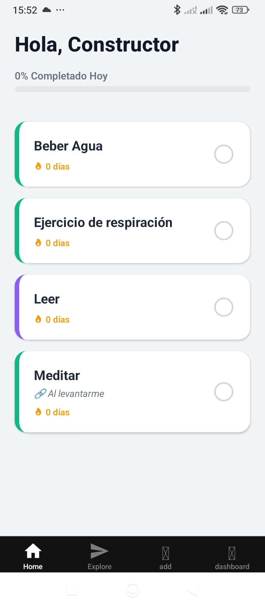
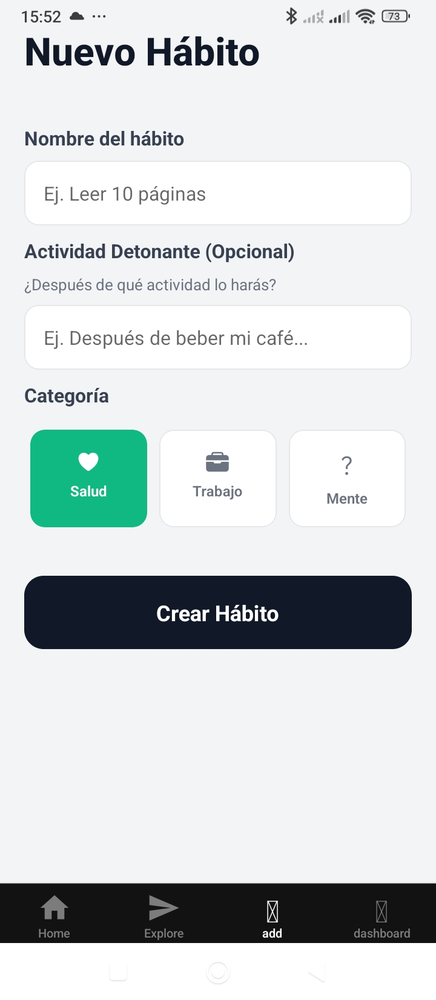
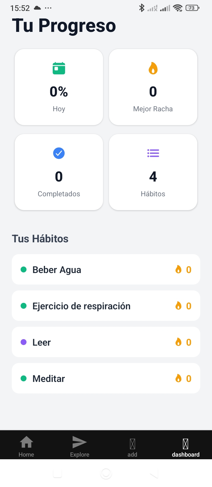

# 🎯 Habit Tracker

App móvil para iOS y Android que ayuda a construir hábitos que duren, aplicando técnicas de psicología del comportamiento.

<p align="center">
  
  
  
</p>

## Qué hace

- **Check-in en un toque** y cálculo automático de rachas (actual y mejor).
- **Habit stacking:** cada hábito nuevo se ancla a una rutina que ya tienes ("después del café, leo 10 minutos").
- **Recordatorios:** varios avisos diarios por hábito, con notificaciones locales.
- **Estadísticas:** racha, total de días, % de cumplimiento en los últimos 30 días y mapa de calor de 5 semanas.
- **Tema claro/oscuro** según el sistema, y **español e inglés**.
- **Onboarding** de 3 pantallas para usuarios nuevos.
- **Funciona sin conexión:** los datos se guardan en el propio móvil.

## La psicología detrás

1. **Intenciones de implementación:** decides cuándo y dónde harás el hábito.
2. **Menos fricción:** completar un hábito cuesta un toque.
3. **Refuerzo inmediato:** feedback visual y háptico al marcarlo.
4. **Identidad:** la racha te ayuda a verte como "alguien que cumple".

## Construida con IA

La app está desarrollada trabajando con **Claude** (Anthropic) como asistente de programación, en más de 20 sesiones documentadas. El repo incluye el método de trabajo completo:

- [`PROJECT_CONTEXT.md`](PROJECT_CONTEXT.md): qué es, para qué se construye y qué no es objetivo.
- [`ARCHITECTURE.md`](ARCHITECTURE.md): decisiones técnicas y por qué.
- [`CLAUDE_HISTORY.md`](CLAUDE_HISTORY.md): bitácora de cada sesión con la IA, con lo que se hizo y las decisiones tomadas.
- [`TODO.md`](TODO.md): lo pendiente.

Mi papel: definir el producto, tomar las decisiones y dirigir y revisar el trabajo de la IA.

## Tecnología

| Tecnología | Para qué |
|---|---|
| React Native + Expo | App multiplataforma iOS/Android |
| TypeScript | Código tipado |
| Zustand | Estado global |
| expo-sqlite | Base de datos local |
| expo-notifications | Recordatorios |
| i18next | Español e inglés |
| Sentry | Registro de errores (opcional) |

## Probarla en local

Necesitas Node.js (LTS) y la app **Expo Go** en el móvil.

```bash
git clone https://github.com/eliwilliamceo/habit-tracker.git
cd habit-tracker
npm install
npx expo start   # escanea el QR con Expo Go
```

## Próximos pasos

- Publicación en App Store y Google Play.
- Después: cuentas de usuario y sincronización con backend.

---

Creado por **William Segovia** · [LinkedIn](https://www.linkedin.com/in/william-segovia)
